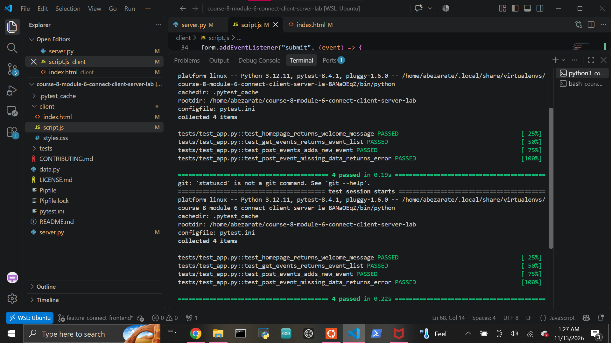

# Client-Server Event Catalog

A lightweight client-server web application built with Flask, HTML, and JavaScript.

The project demonstrates how a browser-based front end communicates with a Flask back end using HTTP requests and JSON data.

## Features

The application supports:

- A Flask API with JSON responses
- `GET /` welcome route
- `GET /events` to retrieve all events
- `POST /events` to create a new event
- Server-side JSON validation
- `400 Bad Request` responses for invalid event data
- JavaScript `fetch()` requests
- Dynamic DOM rendering
- Client-side form validation
- Cross-origin requests using Flask-CORS
- In-memory event storage

## Technologies

- Python 3.12
- Flask
- Flask-CORS
- Pytest
- JavaScript
- HTML
- Pipenv

## Project Structure

```text
course-8-module-6-connect-client-server-lab/
├── client/
│   ├── index.html
│   ├── script.js
│   └── styles.css
├── images/
│   ├── tests-passing.png
│   └── frontend-working.png
├── tests/
│   ├── __init__.py
│   └── test_app.py
├── server.py
├── data.py
├── Pipfile
├── Pipfile.lock
├── pytest.ini
└── README.md
```

## Setup

Install the project dependencies:

```bash
pipenv install
```

Enter the virtual environment:

```bash
pipenv shell
```

Confirm the Python version:

```bash
python --version
```

This project uses Python 3.12.

## Running the Flask Server

From the project root:

```bash
python server.py
```

The Flask API runs at:

```text
http://127.0.0.1:5000
```

## Running the Front End

Open a second terminal and run:

```bash
cd client
python -m http.server 8000
```

Then open:

```text
http://127.0.0.1:8000
```

The front end communicates with the Flask API running on port 5000.

## API Routes

### GET /

Returns a JSON welcome message.

Example response:

```json
{
  "message": "Welcome to the Event Catalog API"
}
```

### GET /events

Returns all event data as a JSON array.

Example response:

```json
[
  {
    "id": 1,
    "title": "Yoga in the Park"
  },
  {
    "id": 2,
    "title": "Lake 5K Run"
  }
]
```

### POST /events

Creates a new event.

Example request:

```json
{
  "title": "Martial Arts Seminar"
}
```

Example response:

```json
{
  "id": 3,
  "title": "Martial Arts Seminar"
}
```

A successful request returns:

```text
201 Created
```

If the request does not contain a valid title, the server returns:

```text
400 Bad Request
```

## Front-End Behavior

When the page loads, JavaScript sends a GET request to:

```text
http://localhost:5000/events
```

The returned events are rendered dynamically into:

```html
<ul id="event-list"></ul>
```

Each event becomes an `<li>` element.

## Creating an Event

When the form is submitted:

1. JavaScript prevents the browser's default form submission.
2. The title is read from the input field.
3. Empty titles are rejected on the client.
4. JavaScript sends a POST request to `/events`.
5. Flask validates the request.
6. Flask creates a new event and returns it as JSON.
7. JavaScript renders the new event immediately.
8. The form resets.

The page does not need to reload.

## Client-Server Flow

```text
Browser
   ↓
JavaScript fetch()
   ↓
Flask API
   ↓
Python event list
   ↓
JSON response
   ↓
JavaScript
   ↓
DOM update
```

## CORS

The Flask server uses Flask-CORS:

```python
CORS(app)
```

This allows the frontend server and Flask server to communicate even though they run on different ports.

For example:

```text
Frontend: http://127.0.0.1:8000
Backend:  http://127.0.0.1:5000
```

## Input Validation

The client validates the title before sending the request.

The server also validates the JSON body so invalid requests cannot bypass browser-side validation.

Missing or blank titles return:

```text
400 Bad Request
```

## In-Memory Data

The server stores event data in a Python list:

```python
events = [
    {"id": 1, "title": "Yoga in the Park"},
    {"id": 2, "title": "Lake 5K Run"},
]
```

New event IDs are generated from the highest existing ID.

Because storage is in memory, restarting the Flask server resets the event list.

## Testing

Run the backend test suite with:

```bash
python -m pytest -v
```

Current result:

```text
4 passed
```

The automated tests verify:

- `/` returns a welcome JSON response
- `/events` returns a JSON array
- POST `/events` creates a new event with status `201`
- missing POST data returns an error response

## Test Evidence



## Front-End Evidence

The client successfully retrieves event data from Flask and dynamically renders newly created events.


## Learning Outcomes

This lab demonstrates how to:

- Build JSON API routes with Flask
- Connect a browser client to a Python server
- Use JavaScript `fetch()`
- Send GET and POST requests
- Process JSON request bodies
- Return structured JSON responses
- Validate data on both the client and server
- Update the DOM dynamically
- Work with CORS
- Test Flask routes using Pytest

## Author

Abraham Zarate